# Architecture — Contexta Lab IDP

How the service is put together, what happens to a document from upload to chart, and what
every table and function is for.

Written for an engineer picking this up cold. Assumes SQL and HTTP, assumes nothing about the
history. Diagrams are Mermaid and follow the project convention — no brackets or apostrophes
inside node labels, every node and subgraph styled — so they render in GitHub and paste onto
the Miro board beside the existing PII diagrams.

---

## 1. The shape of it

A doctor uploads a PDF or a photograph of a lab report. The service reads it, works out which
patient it belongs to from the UHID printed on the page, resolves every printed test name to a
canonical code, stores the result, and waits for a human to confirm before any of it counts.

Three layers, each thin over the one below:

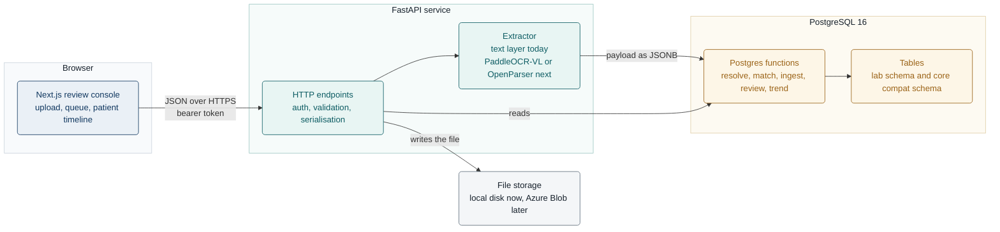

**The database is the product.** The schema, the analyte master and the functions are where
the thinking is. The API calls functions and serialises; the console calls the API and draws.
If you read one folder, read `db/`.

**Why Python for the service.** Both OCR engines that have to land here - PaddleOCR-VL run
locally, and the OpenParser client that calls the same model on a hosted GPU - are Python.
The EMR is TypeScript and Prisma. Rather than force one into the other, this runs
beside the EMR and talks HTTP.

---

## 2. What happens to a document

### 2.1 Ingest

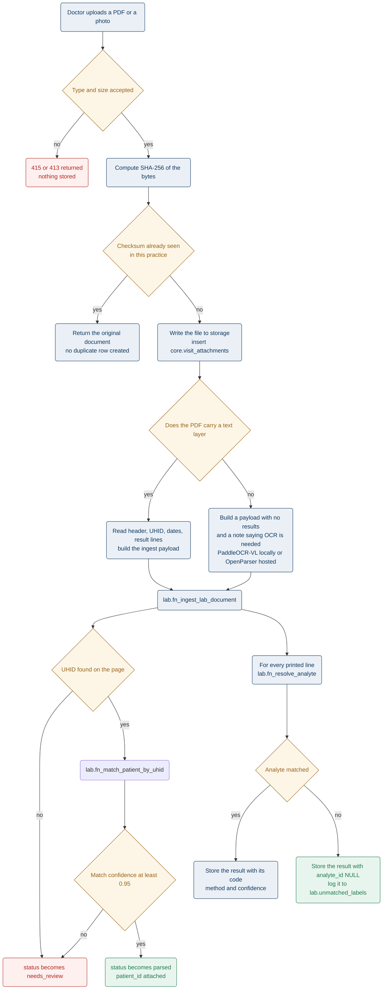

Three things in that flow are deliberate and worth not undoing.

**A fuzzy UHID match does not attach the document.** `fn_match_patient_by_uhid` will return a
close match with a confidence below 1, and the ingest function treats anything under 0.95 as a
suggestion rather than a decision: the patient id is discarded, the guess is written to the
audit trail, and the document waits. A misfiled lab result is a clinical safety event.

**An unmatched test gets NULL, never a guess.** A wrong code silently corrupts a trend line
for years. A blank is visible and fixable, and the label goes to `lab.unmatched_labels` so the
vocabulary can grow.

**Same bytes, same document.** The checksum is unique per practice, so re-uploading a file
returns the original rather than making a reviewer reconcile two rows that say the same thing.

### 2.2 The document lifecycle

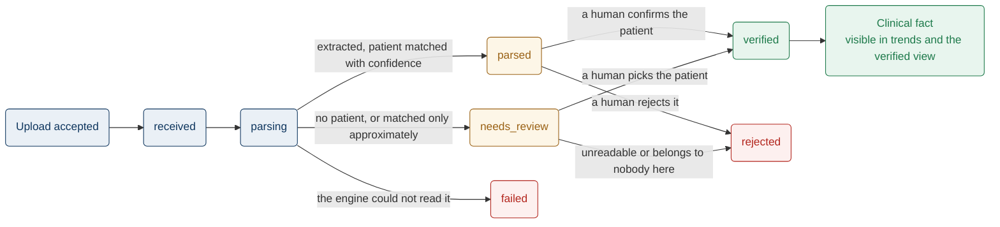

Only `verified` counts. `lab.v_results_verified` and `fn_get_analyte_trend` both read verified
documents and nothing else, and a CHECK constraint on `lab.documents` refuses to let a
document reach `verified` without a `patient_id`.

### 2.3 Review

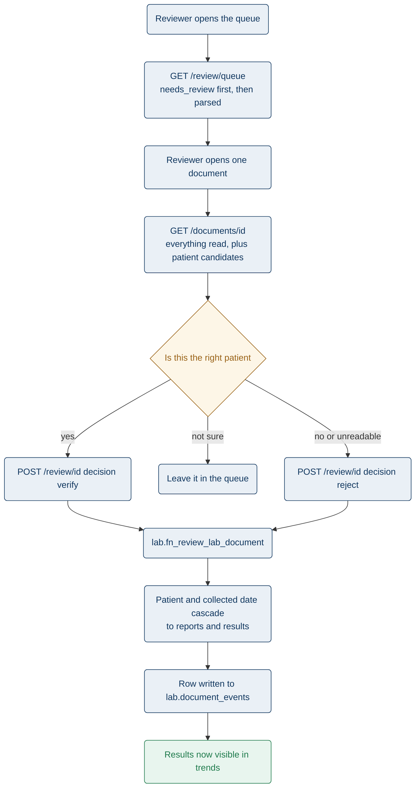

Verification cascades `patient_id` down to reports and results, and copies `collected_at` onto
each result. That denormalisation is what makes a five-year trend one index scan instead of a
join per point.

### 2.4 Reading a trend

```mermaid
flowchart LR
    ASK(Doctor asks for a trend<br/>or opens the patient timeline) --> EP(GET /patients/id/trend/code)
    EP --> AUTH(practice_id taken from the verified token)
    AUTH --> FN(lab.fn_get_analyte_trend)
    FN --> FILTER(Verified documents only<br/>one patient, one analyte, date ordered)
    FILTER --> OUT(Every point returned, no pagination)
    OUT --> CHART(Inline SVG chart<br/>x axis spaced by real dates)

    classDef action fill:#eaf0f6,stroke:#10375f,color:#10375f
    classDef rule fill:#e8f5ee,stroke:#1e7a4b,color:#1e7a4b
    class ASK,EP,FN,CHART action
    class AUTH,FILTER,OUT rule
```

**No pagination, on purpose.** A chart that silently drops a reading is worse than no chart.
Fifteen reports over five years is not a volume problem.

---

## 3. The data model

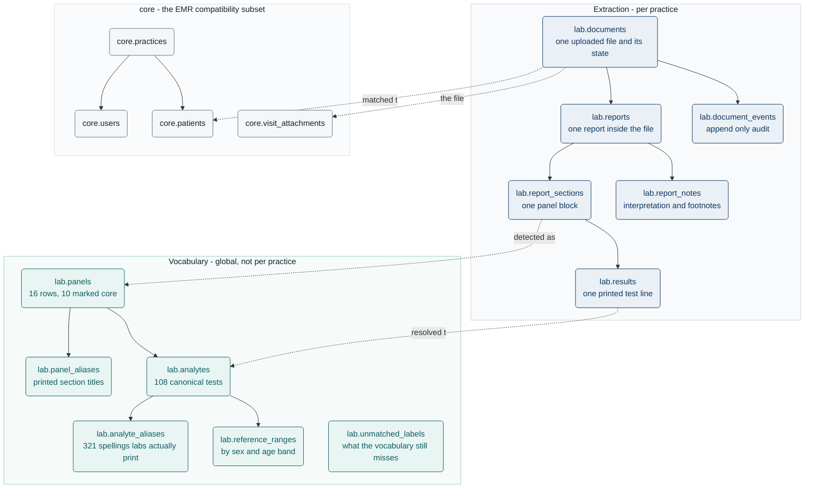

Two halves. The **vocabulary** is global — a haemoglobin is a haemoglobin in every practice —
with an optional `practice_id` on aliases and ranges where NULL means everywhere and a value
means a local override. Everything holding **patient data** is practice-scoped and NOT NULL.

### Conventions on every table

Stated once here rather than repeated per table. Copied from the EMR's `schema.prisma` so this
ports without code changes:

| Column group | Columns |
|---|---|
| Key | `id BIGINT GENERATED ALWAYS AS IDENTITY PRIMARY KEY` |
| Tenancy | `practice_id BIGINT NOT NULL` on everything patient-scoped |
| Soft delete | `is_deleted`, `deleted_at`, `deleted_by` |
| Audit | `created_at`, `created_by`, `updated_at`, `updated_by` |

Timestamps are `TIMESTAMP(6)`. There are no native enums anywhere — `VARCHAR` plus a `CHECK`,
because changing a CHECK is a migration and changing an enum is an outage. Partial indexes are
almost always `WHERE is_deleted = FALSE`, matching the EMR's habit of only indexing the live
subset.

### 3.1 Vocabulary tables

#### `lab.panels`

The canonical panel groups. 16 rows; the ten from the Top 10 Lab Panels reference carry
`is_core = TRUE`.

| Column | Notes |
|---|---|
| `code` | `CBC`, `LIPID`, `KFT` … Contexta internal, **not** LOINC. UNIQUE |
| `display_name` | What a report would call it |
| `is_core` | The ten high-frequency groups |
| `sort_order` | Display order, spaced by 10 so rows can be inserted between |

#### `lab.panel_aliases`

The printed titles a panel arrives under — `Complete Hemogram`, `Haemogram`, `CBC` are all the
CBC panel.

| Column | Notes |
|---|---|
| `alias` | As printed |
| `alias_normalised` | **Generated column**: `regexp_replace(lower(alias), '[^a-z0-9]+', '', 'g')` |
| `practice_id` | NULL means global; a value is a practice-local addition |
| `source` | `seed`, `learned` or `manual` |

Indexes: unique on `(alias_normalised, COALESCE(practice_id, 0)) WHERE NOT is_deleted`, a
plain index on `panel_id`, and a **GIN trigram index** on `alias_normalised` backing the fuzzy
fallback.

#### `lab.analytes`

The canonical tests. 108 rows.

| Column | Notes |
|---|---|
| `code` | `HGB`, `CREAT`, `HBA1C` … UNIQUE |
| `panel_id` | Nullable — an analyte need not belong to a panel |
| `value_type` | `numeric` or `text`. CHECK constrained |
| `default_unit`, `decimals` | How it is normally printed. `decimals` CHECK 0–4 |
| `is_derived` | VLDL, LDL, NON_HDL, both lipid ratios, BUN, GLOB, AG_RATIO, BILI_I, EAG, UIBC, TSAT, EGFR, ANC, ALC |
| `derivation_note` | The formula in words, for example `TRIG / 5` |
| `loinc_code` | Reserved for a later mapping. Empty by design |

#### `lab.analyte_aliases`

**The table the whole pipeline turns on.** 321 rows.

The same test arrives as `Creatinine, Serum`, `S. CREATININE`, `Sr.Creat` and
`CREATININE (SERUM)`. Query the raw printed label and a trend line silently plots three points
where there should be seven.

| Column | Notes |
|---|---|
| `alias` | One spelling |
| `alias_normalised` | Generated, same expression as panel aliases |
| `confidence` | 1.0 for seeded aliases; CHECK `> 0 AND <= 1` |
| `source` | `seed`, `learned`, `manual` |
| `requires_panel_id` | NULL means the alias always applies. A panel id means it applies **only** under that panel, and then it beats the unconditional alias. Added in `007` |

Indexes: unique on `(alias_normalised, COALESCE(requires_panel_id, 0), COALESCE(practice_id, 0))`,
one on `analyte_id`, one on `requires_panel_id`, and a **GIN trigram index** — without it the
fuzzy pass does a sequential scan of every alias.

The `requires_panel_id` column in that unique key is what makes panel disambiguation possible
at all; see section 4. Before `007` the key was `(alias_normalised, COALESCE(practice_id, 0))`,
which permitted exactly one analyte per spelling globally.

#### `lab.reference_ranges`

A haemoglobin of 12.4 is normal for a woman, low for a man, and normal for a six-year-old. One
row per applicable band; the most specific match wins.

| Column | Notes |
|---|---|
| `sex` | `M`, `F`, or NULL for any. CHECK constrained |
| `age_min_years`, `age_max_years` | NULL means unbounded. CHECK min < max |
| `range_low`, `range_high` | Numeric bounds where they exist. CHECK low <= high |
| `range_text` | The printable form: `13.0 - 17.0`, `< 200`, `Absent`, `Non Reactive` |
| `source` | `contexta_default`, `contexta_default_sex`, `contexta_default_paediatric` |

Both the numeric bounds and the text are kept, because not every range is numeric.

#### `lab.unmatched_labels`

Every printed label that resolved to nothing, with an occurrence count. The work queue for
growing the vocabulary, and the honest measure of how much of the real world it still misses.
Unique on `(label_normalised, COALESCE(practice_id, 0))`; the ingest function upserts and
increments.

### 3.2 Extraction tables

#### `lab.documents`

One uploaded file and its extraction state. The blob itself lives in
`core.visit_attachments`; this row owns parsing, matching and review.

| Column | Notes |
|---|---|
| `visit_attachment_id` | The file. FK added in `006`, so `lab` installs standalone |
| `patient_id` | **NULL until matched.** NULL plus `needs_review` is the quarantine state |
| `detected_uhid`, `detected_uhid_label`, `detected_patient_name` | What was read off the page, verbatim |
| `patient_match_method` | `uhid_exact`, `uhid_normalised`, `uhid_fuzzy`, `name_dob`, `manual`, `none` |
| `patient_match_confidence` | CHECK 0–1 |
| `status` | The seven states in the lifecycle diagram. CHECK constrained |
| `source` | `emr_upload`, `patient_portal`, `bulk_import`, `whatsapp`, `email`, `api` |
| `has_text_layer`, `ocr_engine`, `engine_version`, `extraction_confidence` | How it was read, and how well |
| `checksum_sha256` | Dedupe key |
| `is_synthetic` | TRUE for corpus fixture rows. Deletable in one statement |

Constraints and indexes worth knowing:

- `documents_verified_needs_patient` — **CHECK that a verified document has a patient.** The
  guardrail that stops an orphaned result becoming clinical fact.
- Unique `(practice_id, checksum_sha256) WHERE NOT is_deleted` — same file, same document.
- `documents_review_idx` on `(practice_id, status, received_at DESC)` filtered to
  `needs_review` and `parsed` — the review queue reads exactly this.

#### `lab.reports`

One lab report inside the file. Usually one per document, but a register page or a discharge
summary can carry more, and a two-page report is still one report.

Carries both the **printed** and the **parsed** form of the identifying fields:
`uhid_printed`, `patient_name_printed`, `age_printed`, `collected_text`, `reported_text`
alongside `collected_at` and `reported_at`. Indian reports print DD/MM/YYYY; keeping the text
is the audit trail when a parse turns out wrong.

`layout_hint` and `header_hint` record the shape of the page, which is what a future
layout-fingerprint matcher would key on.

#### `lab.report_sections`

One panel block. `panel_id` is the detected panel, `panel_match_method` how it was detected:
`title_alias`, `title_fuzzy`, `analyte_vote`, `manual`, `none`. `analyte_vote` is for the case
where the heading matched nothing but the rows underneath were mostly one panel — a lab that
groups by specimen rather than by panel.

#### `lab.results`

One printed test line. The atom everything else is built from.

| Column | Notes |
|---|---|
| `printed_label` | As printed. NOT NULL |
| `analyte_id` | **NULL when nothing matched.** An honest blank |
| `match_method` | `exact_alias`, `normalised_alias`, `fuzzy_alias`, `manual`, `none` |
| `value_text` | **Verbatim** — `03`, `<0.01`, `Not Detected`, `++`. Never cleaned up |
| `value_numeric` | Parsed when it is a number. NULL for text results, and NULL is not zero |
| `value_operator` | `<`, `>`, `<=`, `>=` split off the front, so `<0.01` charts without pretending to be exactly 0.01 |
| `unit_printed` / `unit_canonical` | Canonical is **not yet populated** — unit normalisation is unbuilt |
| `reference_printed`, `ref_low`, `ref_high` | As printed, plus bounds where parseable. Filled by a BEFORE INSERT trigger added in `008` — 93% of printed ranges parse; the rest are text ranges like `Absent` |
| `flag` | `H`, `L`, `HH`, `LL`, `A`, `N`. CHECK constrained |
| `collected_at` | **Denormalised from the report** so a trend is one index scan |
| `corrected_from_analyte_id` | What the machine thought before a human changed it — the training signal for the alias master |

The index that matters: `results_trend_idx` on
`(practice_id, patient_id, analyte_id, collected_at DESC)` filtered to live rows with a
non-null analyte. There is a second partial index on unmatched rows for the review queue.

#### `lab.report_notes`

Interpretation paragraphs, footnotes, method remarks, legends. `note_type` is CHECK
constrained to `interpretation`, `footnote`, `remark`, `advice`, `method`, `legend`.

#### `lab.document_events`

Append-only. Every status change with its actor and a JSONB detail blob. A misfiled result is
a safety event; when one happens, this is the table that answers how.

#### `lab.v_results_verified`

The read model. Results joined to analyte and panel, filtered to verified documents.
**Anything reading lab data for clinical use should read this, not `lab.results`.**

### 3.3 The `core` compatibility schema

`core.practices`, `core.users`, `core.patients`, `core.visit_attachments` — created by
`000_core_compat.sql` with the EMR's **exact** table names, column names and types.

They are deliberately partial: `core.patients` in the EMR has forty columns and we create the
ones the lab pipeline reads. Adding the rest later is additive.

**The point:** when this service is pointed at the real EMR database, you drop `000` from the
run order and nothing else changes — not a query, not a function, not a line of API code.

`core.patients.uhid` is `VARCHAR(20)` because it is `VARCHAR(20)` there. Do not widen it here
alone; a UHID that fits one and not the other is a bug that surfaces on migration day.

---

## 4. Alias resolution, in detail

The single most important piece of logic in the service.

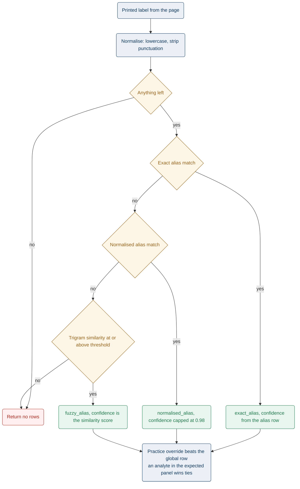

**Normalisation does not make the four creatinine spellings equal.** `S. CREATININE` becomes
`screatinine`, `Sr.Creat` becomes `srcreat`, `Creatinine, Serum` becomes `creatinineserum`.
Those are three different strings. Normalisation only kills case and punctuation; each real
spelling is seeded as its own alias, and the trigram pass catches what neither covers.

**Panel context disambiguates, through `requires_panel_id`.** An alias row is either
unconditional (`requires_panel_id` NULL, which is almost all of them) or scoped to one panel.
A scoped alias is only a candidate when the section resolved to that panel, and when it is, it
beats the unconditional one:

| Printed | Section resolved to | Resolves to |
|---|---|---|
| `ALBUMIN` | `URINE_ROUTINE` | `UR_PROT` — the scoped alias wins |
| `ALBUMIN` | `LFT` | `ALB` — the scoped alias is not eligible |
| `ALBUMIN` | nothing (`Biochemistry Screen`) | `ALB` — the unconditional default |

This was broken until `007`. The unique index permitted one analyte per spelling globally, so
there was never a tie for the panel clause to break and the feature could not happen. 17 rows
in the corpus print `ALBUMIN` or `ALB` under a urine heading and mean urine protein — values
`Absent`, `Trace`, `++` — and all 17 resolved to serum albumin. Measured after `007`: **0 wrong
codes across all 4,177 answer-key rows, and no serum albumin regressed.**

Note what was *not* done: `Glucose` is left alone. Bare `Glucose` is seeded to `UR_GLU` and
`GLU_F` carries only qualified spellings, so the corpus produces no glucose mismatch today.
The mechanism is there when a report proves otherwise.

**Two candidates and nothing to separate them means NULL.** If a pass ends with two analytes
and neither is a practice override, nor panel-scoped, nor in the requested panel, the function
returns no rows. An arbitrary pick between two clinical codes is the one outcome this service
must never produce.

**Thresholds.** Analytes default to trigram similarity ≥ 0.62, panels to ≥ 0.66, UHIDs to
≥ 0.80. All three are parameters, not constants in the body.

---

## 4a. The OCR engines

52 of the 300 corpus PDFs, and every phone photograph a clinic will ever receive, have no text
layer. Reading those needs OCR, and two engines already exist and are tested in the idp
workspace at `../VectorDB_Analysis/idp/code/`.

| Engine key | What it is | Speed | Cost | Residency |
|---|---|---|---|---|
| `paddle_vl` | PaddleOCR-VL 1.6 on this machine, CPU | **~20 minutes a page** | free | **In boundary** — nothing leaves the network |
| `openparser` | The same model on OpenParser's hosted GPU | **~6 seconds** | ~₹0.09 a page | **Leaves India** — the whole PDF is uploaded to `api.openparser.dev` in the United States |

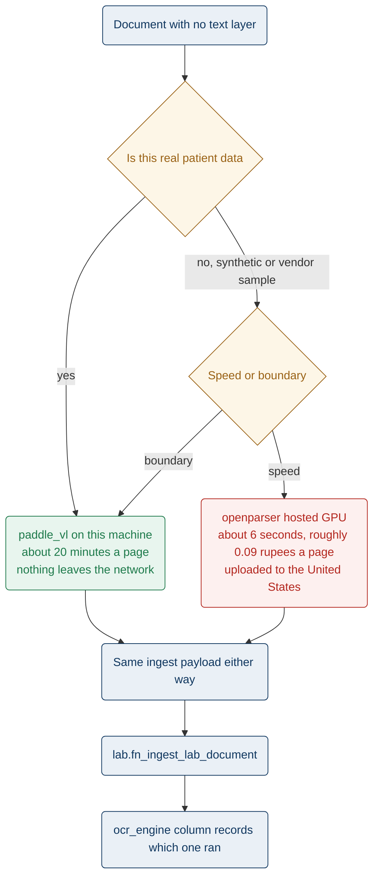

**The 200x difference is why OpenParser exists.** It is also why it cannot be the default. The
Streamlit app in the idp workspace gates it behind an explicit `--allow-remote` flag and a
warning that reads *this leaves India*, and restricts it to **synthetic and vendor sample
documents only, never a real patient report**. That rule has to survive into this service.

It also conflicts directly with the decision already on record: production PHI belongs on
Azure Postgres in an India region. Sending the same PHI to a US OCR endpoint gives that up at
a different layer. The resolutions are a GPU inside the boundary, or a hosted engine with an
India region, or accepting 20 minutes a page — that is a decision for RK, not for whoever
wires up the integration.

OpenParser practicalities, from the tested engine in `idp/engines/openparser.py`: it needs an
API key in `.env`, it is a **deferred-job API** — submit, then poll until the job finishes —
it retries rate limits and refused connections, it never retries a rejected request, and it
refuses an oversized document before uploading it. Its response shape was taken from
`api.openparser.dev/openapi.json` rather than the prose docs, because the two prose pages
contradict each other.

**Whichever engine runs, `lab.documents.ocr_engine` records which one it was**, so a result
can always be traced back to how it was read. Expected values: `pdf-text` (a text layer, no
OCR needed), `paddle_vl`, `openparser`, or `none` (stored but unread).

---

## 4b. The three extraction passes

An engine returns **blocks**, not results. Turning blocks into rows is a separate problem, and
it is solved three different ways depending on how much structure survived the page.

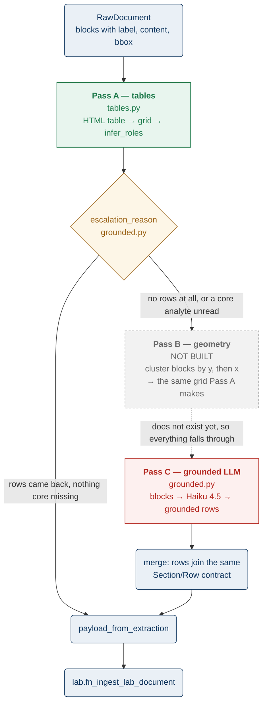

| Pass | Where | Status | Cost | Covers |
|---|---|---|---|---|
| **A** — tables | `ocr/tables.py`, `ocr/columns.py` | built | ₹0 | ~93% of documents |
| **B** — geometry | — | **designed, not built** | ₹0 | would catch loose blocks that still sit in rows |
| **C** — grounded LLM | `ocr/grounded.py` | built, measured | ~₹0.06 a document | the 7.7% where A returns nothing |

**Pass B's absence is why Pass C fires as often as it does.** The ladder is meant to try geometry
before spending money; with the middle rung missing, everything Pass A drops falls to Pass C.
The five-step plan for building it is in `docs/extraction-strategy.md` §7.

### 4b.1 When Pass C fires

`escalation_reason(extraction, coverage=None)` returns a reason or `None`. Two signals:

- **no rows at all** — the thermal slips, the screenshots. Available everywhere.
- **a core member of a detected panel was not read** — a partial read, which is the more
  dangerous case because the page looks fine until someone counts. Needs a coverage report,
  so it needs a database connection.

An **unresolved label does not escalate**. A label we hold no code for is usually a gap in the
vocabulary rather than a failure to read, and escalating those would fire on documents that are
entirely correct.

> **Known gap.** `scripts/ocr_worker.py` passes `coverage=None`, because it holds no per-document
> database connection. So in the worker only the row-count signal fires today, and partial reads
> are caught on the review screen instead of here.

Measured over the 300 recorded extractions: **23 documents, 7.7%**.

### 4b.2 What leaves the machine

This is the part to read before changing anything. `select_blocks(raw)` is the only thing between
a patient's UHID and a third party.

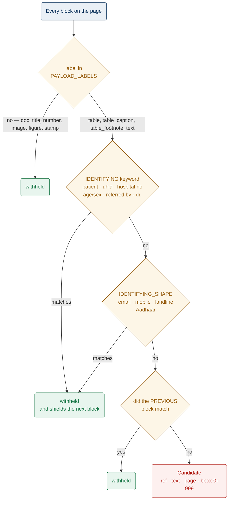

**The follows-a-label rule is load-bearing, and not obvious.** These engines emit a header as two
consecutive blocks — the label and then the value — and only the first contains a word any keyword
list can match:

```
[text] Hospital No          ← IDENTIFYING matches
[text] MCH/226104           ← matches nothing. This is the UHID.
```

So a block that *follows* an identifying one is withheld too, whether or not the first was dropped
for another reason. Measured across the 23 escalating documents:

| | blocks |
|---|---|
| Total on those pages | 410 |
| Withheld by keyword or shape | 61 |
| **Withheld only by the follows-a-label rule** | **58** |
| Sent | 291 → **204 after the label filter**, averaging 9 a document |

**`select_blocks` fails closed.** An unrecognised block label is not sent, because an unclassified
block might be the letterhead and the control only works if unknown means no.

> **Why this is permitted at all.** `pii-masking-layer-and-architecture.md` §10 in the analysis
> workspace rules out sending the **image** to an external model — you cannot redact a photograph
> before you have read it, and finding the name needs the same vision pass you were trying to
> avoid. Pass C runs *after* OCR, on text that already exists, which is the case that section does
> not cover. The same document, whole and unredacted, already goes to `api.openparser.dev`.

### 4b.3 The request

Plain Anthropic Messages API. No SDK, no streaming, no tools — `requests.post`, because the worker
already carries `requests` for OpenParser and nothing here needs more.

```
POST https://api.anthropic.com/v1/messages
x-api-key: <from ANTHROPIC_API_KEY, worker only>
anthropic-version: 2023-06-01
content-type: application/json

{ "model": "claude-haiku-4-5-20251001",
  "max_tokens": 2048,
  "system": "<the reading instructions>",
  "messages": [ { "role": "user", "content": "<the blocks>" } ] }
```

The user content is one line per block — `ref`, page, quantised box, then the text verbatim:

```
b0 @1:30,62,250,70    Accession No.
b1 @1:30,71,237,80    MCH23-047304
b7 @1:30,232,197,242  Plt Count
b8 @1:742,243,963,253 96000 /uL L
```

**Coordinates are integers 0–999, normalised per page.** That is the LMDX scheme: position is most
of what separates a label from its value on a page with no table structure, and it is the one
signal the grid passes could not use, because there was no grid to use it in.

**`ref` is an index into what we sent**, not an engine id — so a model citing `b9` when nine blocks
went fails the check rather than landing on something real by accident.

The reply is one pipe-delimited line per row:

```
LABEL_REF | VALUE_REF | LABEL | VALUE | UNIT | FLAG
b7        | b8        | Plt Count | 96000 | /uL | L
```

**Deliberately not JSON mode.** Constrained decoding costs 3–9 points of accuracy across
open-weight models, and one benchmark saw output validity *fall* from 51% to 37% under structured
output — sources in `docs/extraction-strategy.md`. A malformed line is simply not a row. The
guarantee is the grounding check, not the schema.

### 4b.4 One escalated document, end to end

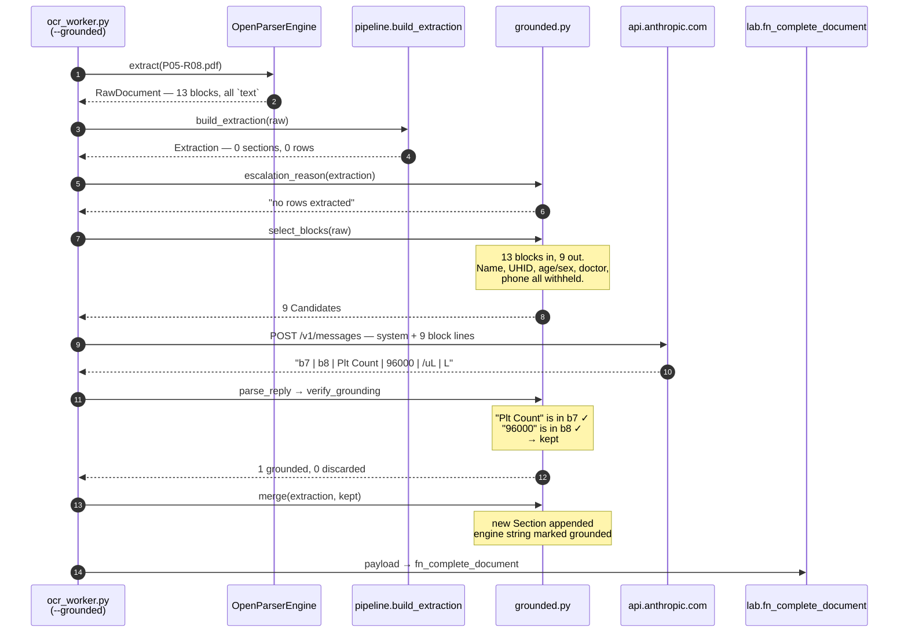

### 4b.5 The grounding check

`verify_grounding(rows, sent)` returns `(kept, rejected)`. A row survives when **both cited blocks
were sent**, the label appears in the label's block, and the value appears in the value's block.

Each half grounds against **its own** block. The first version demanded both in one block and
rejected correct readings for being correctly attributed — on a till roll the label and the value
are always separate blocks, which is the entire reason this pass exists. Grounding them separately
is a correction, not a relaxation:

| Attack | Caught by |
|---|---|
| Value invented outright | not in any block |
| Value invented inside a real block | not in the block it cites |
| Value borrowed from another test | not in the block it cites |
| Block id invented | was not sent |
| Label attached to the wrong block | not in the block it cites |

**Rejected rows carry a `reject` key naming the test they failed.** The rejection rate is the
measurement that says whether this pass is earning its money.

### 4b.6 Where the key lives

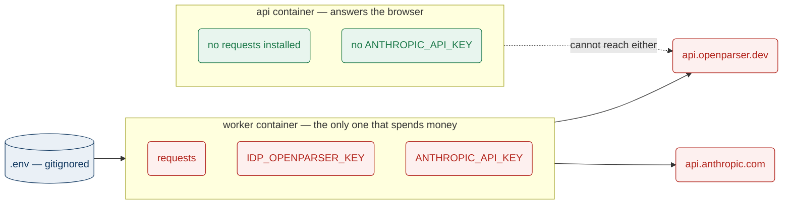

Enforced in three places, not one: the api image installs no `requests`, `docker-compose.yml`
passes `ANTHROPIC_API_KEY` to `worker` and not to `api`, and `--grounded` exits immediately
without a key rather than running most of a corpus and skipping quietly.

`GroundedUnavailable` — no key, no `requests`, or an API that gave up — is **never fatal**. A
document that could not be escalated keeps whatever the grid passes got, which is exactly where
it already was.

### 4b.7 What it recovered

Measured 2026-10-08 over the 23 escalating documents, from the cached `bench/results/*.raw.json`
dumps. Full output in `bench/reports/2026-10-08-grounded-trial.json`.

| | |
|---|---|
| Rows the answer key says are on those pages | 36 |
| **Rows the grid passes produced** | **0** — that is why they escalated |
| **Rows Pass C recovered** | **25 — 69.4%** |
| **…with the correct value** | **25 — 100%** |
| Rows matching no key row | 1 |
| Cost | **₹1.44**, 22 calls |

| Layout | Docs | Printed | Recovered |
|---|---:|---:|---:|
| `thermal_slip` | 17 | 19 | **16** |
| `chat_screenshot` | 3 | 9 | **9** |
| `boxed_panels` | 1 | 6 | 0 |
| `handwritten_full` | 1 | 1 | 0 |
| `handwritten_values` | 1 | 1 | 0 |

`thermal_slip` was the single largest recall hole in the 2026-09-23 benchmark — 17 of the 26 empty
reports — and is now 84% recovered. `handwritten_full` staying at zero is correct behaviour; that
page is deliberately illegible.

**`chat_screenshot` returned 9 of 9**, and `docs/extraction-strategy.md` §7 lists it under *"Not
building — genuine engine limits. Manual entry is correct."* That decision was made before anyone
tried it and should be revisited.

**Caveat worth keeping attached to these numbers:** 36 rows is a small sample and 25 of them come
from one layout family. It is a real measurement, not yet a corpus-level claim.

---

## 5. The functions

The API calls these and does not write `lab.*` directly. Every one takes `p_practice_id`
explicitly, and every one is `SECURITY INVOKER` so a role with no rights to `lab.*` cannot
borrow any through a function.

| Function | Volatility | Returns | Does |
|---|---|---|---|
| `fn_normalise_label(text)` | IMMUTABLE | text | Lowercase, strip non-alphanumerics. Backs the generated columns |
| `fn_resolve_analyte(practice, label, panel, min_sim)` | STABLE | table | Printed label to canonical analyte, with method and confidence. Panel-scoped aliases beat unconditional ones; an unresolvable tie returns nothing. Replaced in `007` |
| `fn_resolve_panel(practice, heading, min_sim)` | STABLE | table | Printed heading to canonical panel |
| `fn_match_patient_by_uhid(practice, uhid, min_sim)` | STABLE | table | The auto-detect step. Fuzzy hits score below 1 |
| `fn_ingest_lab_document(practice, payload, actor)` | VOLATILE | bigint | Writes the whole document tree in one transaction |
| `fn_review_lab_document(practice, doc, patient, actor, decision, note)` | VOLATILE | varchar | A human confirms or rejects; cascades down |
| `fn_get_analyte_trend(practice, patient, code, from, to)` | STABLE | table | Every verified point for one analyte, date ordered |

### The ingest payload

The contract between the extractor and the database. Documented on the function itself; the
shape is what `api/app/services/extract.py` builds and what `scripts/load_corpus.py` builds.

```
{
  source, visit_attachment_id, checksum_sha256, page_count, has_text_layer,
  ocr_engine, engine_version, extraction_confidence, is_synthetic,
  reports: [{
    lab_name, accession_no, uhid_printed, uhid_label_printed,
    patient_name_printed, age_printed, sex_printed,
    collected_text, collected_at, reported_at,
    referring_doctor, department, specimen, layout_hint, header_hint,
    sections: [{
      heading_printed,
      results: [{ printed_label, value_text, unit_printed, reference_printed,
                  method_printed, flag, is_text_result, extraction_confidence }]
    }],
    notes: [{ note_type, marker, note_text }]
  }]
}
```

**Replacing the extractor changes nothing else.** When OCR lands - PaddleOCR-VL locally or
OpenParser hosted, see section 4a - it produces this same JSON with `ocr_engine` set to
whichever ran, and `extract_document()` is the only function that changes.

---

## 6. Tenancy and safety

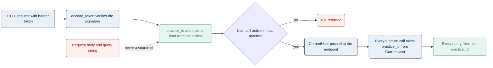

- **`practice_id` comes from the signed token.** Never from a body field, a query string or a
  header a client can set. A client that could choose its own practice id is a cross-tenant
  PHI leak waiting for an unlucky request.
- **The user is re-checked every request.** A revoked reviewer stops being able to verify
  documents immediately, not when their token happens to expire.
- **Ids cross the wire as strings.** PostgreSQL BIGINT goes to 2^63; JavaScript loses integer
  precision above 2^53. `parse_id()` on the API side enforces `/^\d+$/` before casting;
  `web/lib/api.ts` keeps them as strings throughout.
- **Login failures say the same thing either way.** A different message for an unknown address
  tells an attacker which addresses are real.

---

## 7. Where to start reading, and what will bite

**Read in this order:** `db/001` and `db/002` for the shape, `db/003` for the logic,
`api/app/routers/documents.py` for how a request becomes a database call, then
`web/app/review/page.tsx` for what a reviewer actually sees.

Things that will surprise you:

**52 of the 300 corpus PDFs have no text layer.** The CSS filters that produce the damage
force the browser to rasterise the page. That is correct for a photograph, and it means the
current extractor stores those documents and reads nothing from them — by design, rather than
inventing values.

**The current extractor is a text-layer reader, not the production engine.** It handles the
clean half of the corpus. The next integration is one of the two OCR engines in section 4a —
`paddle_vl` locally or `openparser` hosted — and the payload shape above is the whole
contract. Do not reach for OpenParser on real patient data without settling the residency
question first.

**Migrations run 000 through 008.** `006` adds the `visit_attachment_id` foreign key that
`002` defers so the lab schema can install without `core`. `007` adds `requires_panel_id` and
replaces `fn_resolve_analyte`; see section 4 for why. `008` parses `reference_printed` into
`ref_low` and `ref_high`, which nothing had ever written, so the chart's reference band works.

**Measured on the first real run.** 300 documents ingested, 287 verified, 13 quarantined on
OCR-mangled UHIDs. Scored against the sealed answer key by `scripts/score_corpus.py`:
4,065 right of 4,069 (99.90%), 4 honest blanks, **0 wrong codes**.

**Seeded users have no password hash**, so nobody can log in until you run
`python scripts/set_password.py <email>`. That is a script and not a migration on purpose: a
migration is committed, and a password must not be.

**`unit_canonical` is never written.** Unit normalisation — mg/dL versus mg/dl versus MG/DL —
is not built.

**Migrations are hand-written and applied in order.** Do not edit one that has been applied;
`run_migrations.py` compares checksums and will tell you off. Write a new file.
